<h1 align="center">Lucas Henrique Gomes Medeiros</h1>

  <strong>Estudante de Análise e Desenvolvimento de Sistemas · Foco em Back-end</strong> 
  Java · Spring Boot · Python · C · C++ APIs REST · Arquitetura serverless

  
  
  

---

  

<picture>
  <source media="(prefers-color-scheme: dark)" srcset="https://raw.githubusercontent.com/LucasLeoHGM/LucasLeoHGM/output/pacman-contribution-graph-dark.svg">
  <source media="(prefers-color-scheme: light)" srcset="https://raw.githubusercontent.com/LucasLeoHGM/LucasLeoHGM/output/pacman-contribution-graph.svg">
  
</picture>

## Sobre mim

Sou estudante de **Análise e Desenvolvimento de Sistemas na CESAR School** (Recife) e já estudei **Software Engineering na Jala University**. Meu foco é o desenvolvimento **back-end**: construir serviços bem estruturados, testáveis e fáceis de manter.

- Atuo em projetos acadêmicos em grupo, com versionamento, revisão de código e divisão de tarefas em tickets
- Tenho experiência com **Java (Spring Boot)**, **Python** e **JavaScript/TypeScript**
- Ministro aulas de robótica em um projeto social voltado a jovens em contexto socioeducativo
- Gosto de problemas que unem back-end, dados e automação
- Curto jogos e penso em ser game dev como hobby
- **Idiomas:** Português (nativo) · Inglês (C1) · Francês (A2)

## Reconhecimentos

- **2026.1:** Projeto destaque na **Tech Night 2026.1** da CESAR School, com o **FaltaFatal**
- **2026.1:** Participação na **Mostra TechDesign 2026.1**, onde fui **líder dos projetos**
- **2025.2:** Projeto destaque selecionado para o **Demo Day do Porto Digital**, entre os 10 melhores projetos, com o **Edu Digital**

## Projetos em destaque

| Projeto | O que faz | Stack |
|---|---|---|
| [**Validador-Cartas**](https://github.com/LucasLeoHGM/Validador-Cartas) | Projeto de grupo de validação de documentos, com MVP focado em comprovante de residência. Combina extração de texto (OCR), processamento de imagem e IA. | Java, Spring Boot, OpenCV, Tesseract |
| [**Rota Vital**](https://github.com/Luisr-nunes/projeto_Rota_Vital) | Projeto integrador do 3º semestre na CESAR School: aplicação web para gerenciar e distribuir hemocomponentes, inspirada na rede de sangue do SUS e com dados sintéticos. Controla estoque, atende pedidos de hospitais, aloca unidades compatíveis por validade (FEFO) e calcula rotas de entrega com cadeia fria usando Dijkstra, além de painéis de monitoramento. Trabalho em equipe de 7 pessoas. | Java, Spring Boot |
| [**Rota_Vital_Serverless**](https://github.com/LucasLeoHGM/Rota_Vital_Serverless) | Função HTTP serverless que devolve a guia de transporte do sistema Rota Vital, executável em emulador local e opcionalmente na nuvem. | Python, serverless |
| [**Projeto_Safyra**](https://github.com/LucasLeoHGM/Projeto_Safyra) | Projeto social de ensino de robótica para jovens em contexto socioeducativo, no qual atuo como instrutor. O repositório reúne o código desenvolvido durante as aulas. | Python, robótica |
| [**Dino Runner**](https://github.com/LucasLeoHGM/Dino-MOD2-LH) | Projeto antigo: jogo no estilo do dinossauro do Chrome (endless runner), feito durante um curso de programação. | Python |
| [**FaltaFatal**](https://github.com/LucasLeoHGM/FaltaFatal) | 🏆 Projeto destaque na Tech Night 2026.1 da CESAR School. 🏆 Projeto destaque na Mostra TechDesign 2026.1 da CESAR School. Jogo de adivinhação de números com interface gráfica e progressão estilo RPG, tema cyberpunk. Salva cada sessão em arquivo e calcula estatísticas de desempenho (média de tentativas, melhor/pior resultado, desvio padrão). | C, Raylib |

## Tecnologias

**Linguagens**

**Back-end e frameworks**

**Bancos de dados**

**Cloud, DevOps e ferramentas**

## Estatísticas do GitHub

  

## Contato

Aberto a conversas sobre estágio, projetos e oportunidades em desenvolvimento back-end. O melhor canal é o [LinkedIn](https://linkedin.com/in/lucas-henrique-hgm).

  

